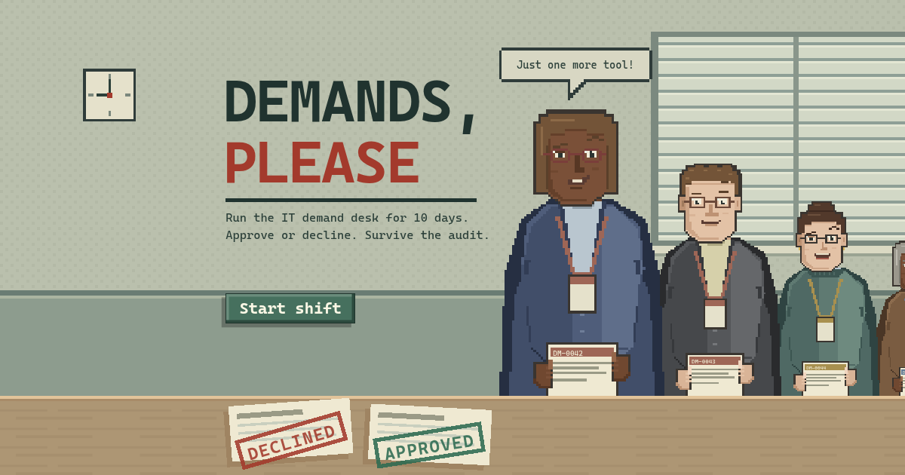

### Everyone wants just one more tool. You decide who gets it.

**[▶ Play free in your browser](https://demands-pls.demands-pls.workers.dev)**

 

Ten working days at the company's IT demand desk. Colleagues line up all day, each with a ticket for the software they _really_ need. Check the paperwork, approve or decline, and get through the queue by five. Anyone you don't see by closing time buys their own tool, and that's shadow IT.

Every morning IT governance sends a new rule, and the old rules still apply.

 

  

