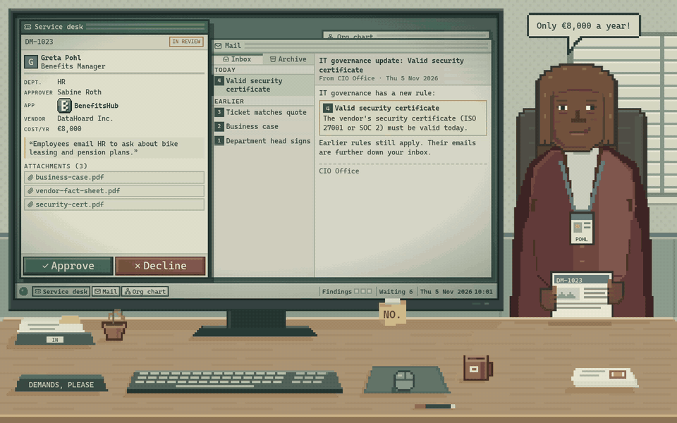
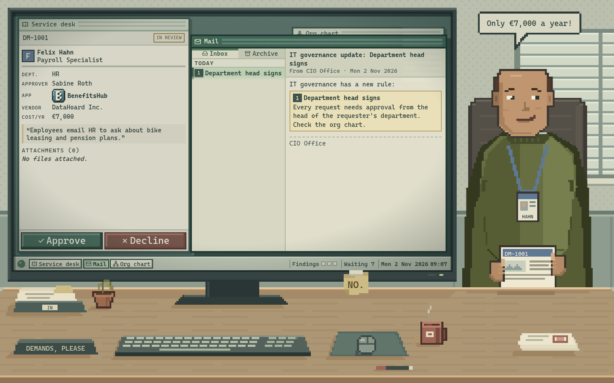
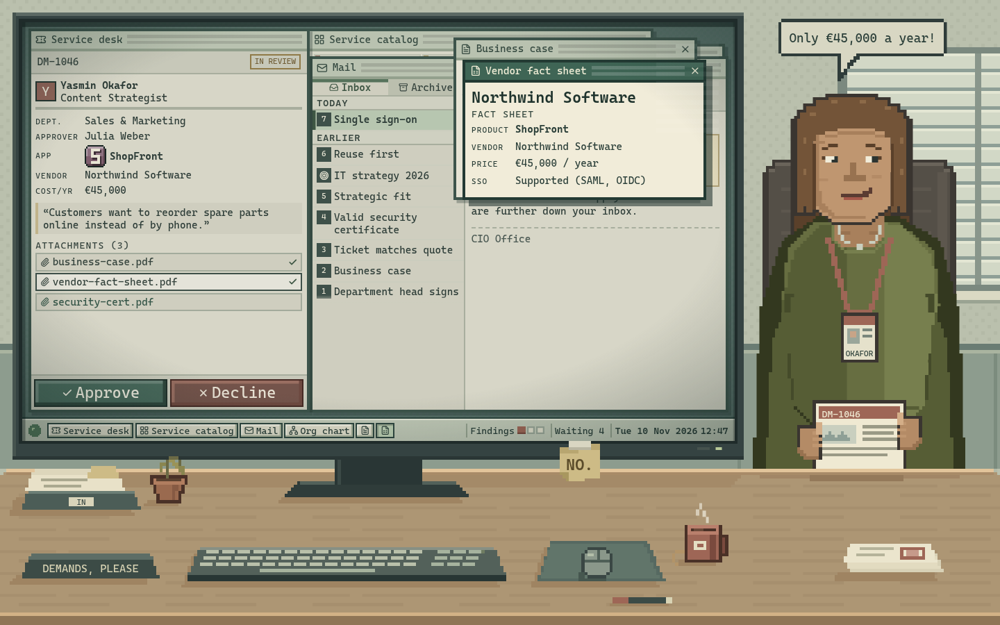
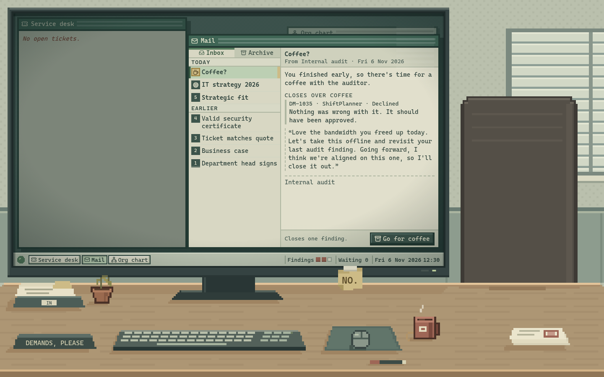
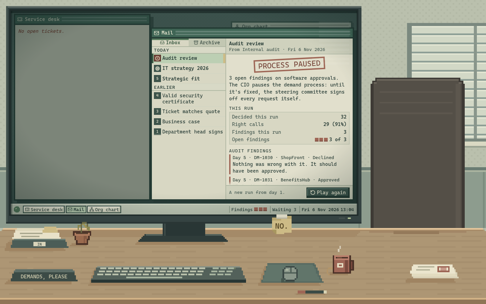
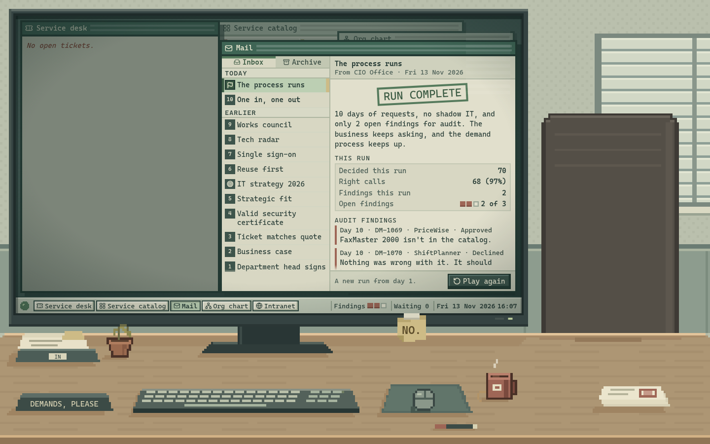

### Everyone wants just one more tool. You decide who gets it.

**[▶ Play free in your browser](https://demands-pls.demands-pls.workers.dev)**

No download, no sign-up. A run takes about half an hour.

 

  

 

Ten working days at the company's IT demand desk. Colleagues line up all day, each with a ticket for the software they _really_ need. Check the paperwork, approve or decline, and get through the queue by five. Anyone you don't see by closing time buys their own tool, and that's shadow IT.

Every morning IT governance sends a new rule, and the old rules still apply.

 

<table>
  <tr>
    <td width="50%"></td>
    <td width="50%"></td>
  </tr>
  <tr>
    <td><b>"Only €7,000 a year!"</b> Everyone has a reason. Check who signed off and whether the boss actually runs their department.</td>
    <td><b>Read the fine print.</b> Business cases, vendor fact sheets, security certificates, the org chart, the service catalog. Somewhere in there is the reason to say no. Or there isn't.</td>
  </tr>
  <tr>
    <td width="50%"></td>
    <td width="50%"></td>
  </tr>
  <tr>
    <td><b>Coffee with the auditor.</b> Wrong calls become audit findings. Clear the queue early and a coffee might make one go away.</td>
    <td><b>Three strikes.</b> Three open findings and the CIO pauses the whole process. From then on, the steering committee signs off every request itself.</td>
  </tr>
</table>

 

  

  <b>Make it to Friday of week two</b> with the queue cleared and the auditor happy. 
  Then try again: every run brings new visitors, new apps and new excuses.

 

### [▶ Start your shift](https://demands-pls.demands-pls.workers.dev)

Best on a laptop or desktop screen. Your run is saved in the browser, so you can close the tab and carry on later.

  

Want to build or tinker? See <a href="DEVELOPMENT.md">DEVELOPMENT.md</a>.

